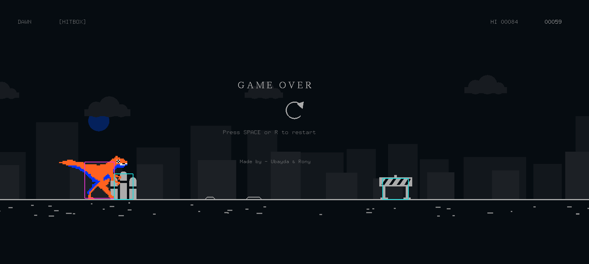

# 🦕 Chrono Run: DN Dash

**An Interactive 2D Endless Runner with Real-Time Day-Night Cycle**

> **Course**: Computer Graphics & Image Processing Lab (CSE-402)  
> **Institution**: Metropolitan University, Sylhet — Dept. of CSE, Section B, 58th Batch  
> **Lecturer**: Shrabanti Chowdhury

---

## 👥 Team

| Name               | Student ID  | Responsibility                                          |
| :----------------- | :---------- | :------------------------------------------------------ |
| Nahdiul Islam Rony | 231-115-069 | Rendering, day-night cycle, parallax, sprite animation  |
| Abu Ubayda         | 231-115-080 | Physics, collision detection, scoring, HUD, game states |

---

## 📁 Project Structure

```
CG-IP-Project/
├── src/
│   ├── main.cpp        ← window setup + callbacks
│   ├── config.h        ← constants
│   ├── colors.h        ← ColorRGB, lerp, smooth01
│   ├── state.h         ← shared structs, enums, globals
│   ├── sprites.*       ← pixel-art sprites + dino themes
│   ├── audio.*         ← synthesized sound effects
│   ├── draw.*          ← drawing primitives, sprite renderer
│   ├── world.*         ← obstacle / skyline generation, scrolling
│   ├── daynight.*      ← day-night palette, sky gradient, phase skip
│   ├── render.*        ← scene, HUD, display()
│   ├── game.*          ← physics, collision, spawning
│   ├── input.*         ← keyboard, mouse, resize/letterbox
│   ├── highscore.*     ← save/load best score
│   └── imgproc.*       ← image-processing filters + BMP screenshot
├── include/GL/  lib/  docs/  presentation/
├── build.bat  run.bat  ChronoRun.exe  freeglut.dll
```

---

## 📸 Gameplay Screenshots

| Daytime & Parallax Skyline | Night Atmosphere & Dino Glow | Post-Processing Filter |
| :---: | :---: | :---: |
|  |  |  |

---

## 🚀 How to Run

### Option 1 — Double-click (Easiest)

```
run.bat
```

Launches `ChronoRun.exe` directly. The `freeglut.dll` must be in the same folder (it already is).

### Option 2 — Build from Source

```bat
build.bat
```

Requires **MinGW g++** on your PATH (or installed at `C:\MinGW\bin\g++.exe`).  
Produces a fresh `ChronoRun.exe`.

### Option 3 — Code::Blocks IDE

Open `ChronoRun.cbp` and press **F9** to build & run.

### Option 4 — Play in Browser (Web Version)

Open `docs/index.html` directly in any browser, or start a local server:

```bat
python -m http.server 8000 --directory docs
```

Then visit: **http://localhost:8000**

---

## 🎮 Controls

| Key | Action |
| :--- | :--- |
| `SPACE` or `↑` | Jump (hold for higher jump) |
| `↓` | Duck / slide under drones |
| `T` | Cycle dinosaur theme (5 skins) |
| `N` | Skip to the next day-night phase (demo) |
| `F` | Cycle image filter (Grayscale / Sepia / Invert / Blur / Edge) |
| `S` | Save screenshot as BMP |
| `P` | Pause / Resume |
| `R` | Restart |
| `H` | Toggle AABB hitbox debugger |
| `M` | Mute / unmute sound |
| `ESC` | Quit |
| Left Click | Jump |
| Right Click (hold) | Duck |

---

## 🦕 Dinosaur Themes (press `T` to switch)

|  #  | Theme Name              | Body Color    | Belly Color   |
| :-: | :---------------------- | :------------ | :------------ |
|  1  | Cyan Raptor _(default)_ | Electric Blue | Golden Yellow |
|  2  | Jurassic Green          | Emerald Green | Lime Yellow   |
|  3  | Crimson Blaze           | Fiery Red     | Orange        |
|  4  | Neon Cyber              | Cyber Violet  | Hot Magenta   |
|  5  | Obsidian Gold           | Charcoal      | Amber Gold    |

> Colors adapt automatically with the **day-night cycle**: the dino glows at night! 🌙

---

## 🎨 Graphics Concepts Demonstrated

| Concept                             | Implementation                                               |
| :---------------------------------- | :----------------------------------------------------------- |
| 2D Orthographic Projection          | `gluOrtho2D`                                                 |
| Raster Pixel-Art Sprites            | `GL_QUADS` bitmap-to-quad renderer                           |
| Frame-Based Animation               | Run cycle, jump, duck, crash poses                           |
| Linear Color Interpolation (`lerp`) | Day-night sky + dino ambient shading                         |
| Multi-Layer Parallax Scrolling      | Far city skyline, near buildings, clouds, ground             |
| AABB Collision Detection            | Runner vs all obstacle types with live debugger              |
| Delta-Time Physics                  | Frame-rate independent jump/gravity                          |
| Procedural Generation               | Obstacles, buildings, clouds, stars                          |
| Synthesized Audio                   | In-memory WAV via `PlaySound` (jump, duck, score, game-over) |

### 🖼️ Image Processing Concepts

| Concept | Implementation |
| :--- | :--- |
| Framebuffer capture | `glReadPixels` into an RGB array |
| Grayscale | Luminance: `0.299R + 0.587G + 0.114B` |
| Sepia | 3×3 color transform matrix |
| Negative / invert | 255 − value per channel |
| Blur | Separable 5-tap box filter (convolution) |
| Edge detection | Sobel operator, gradient magnitude `√(Gx² + Gy²)` |
| Image file output | 24-bit BMP writer (header + BGR rows) |

---

## 🧮 Algorithms & Formulas

| Topic | Formula / Method |
| :--- | :--- |
| Linear interpolation (day-night colours) | `C(t) = C1 + (C2 − C1) · t`, with `t` clamped to [0, 1] |
| Smooth transition | `smooth01(t) = t² (3 − 2t)` (smoothstep, no visible "steps") |
| Sky gradient | Two vertex colours (horizon, zenith) on one `GL_QUADS`; OpenGL interpolates between them |
| Jump physics | `v ← v − g·dt`, `y ← y + v·dt` (delta-time, frame-rate independent) |
| Variable jump height | Releasing the jump key early multiplies upward velocity by 0.55 |
| Jump buffer | An early jump press is remembered for ~6 frames and fires on landing |
| AABB collision | Overlap if `a.x < b.x+b.w ∧ a.x+a.w > b.x ∧ a.y < b.y+b.h ∧ a.y+a.h > b.y` |
| Fair obstacle gap | `minGap = speed · (airTime + 20) + 80`, where `airTime = 2·JUMP_FORCE / GRAVITY` |
| Speed ramp | `speed = BASE + score · RAMP`, capped at `MAX_SPEED` |
| Parallax | Layer scroll speed = `gameSpeed · k` (far 0.10, near 0.25, ground 1.0) |
| Grayscale | `Y = 0.299R + 0.587G + 0.114B` |
| Sepia | 3×3 colour matrix applied to (R, G, B) |
| Blur | Separable 5-tap box filter (horizontal then vertical), 2 passes |
| Edge detection | Sobel kernels Gx, Gy; magnitude `√(Gx² + Gy²)` on luminance |
| Letterboxing | Viewport scaled to fit while keeping 1000:450, centred, with `glScissor` |

---

## ⚠️ Notes
- Windows only (uses `windows.h` and `PlaySound`).
- Image filters run on the CPU after `glReadPixels`, so Blur and Edge are the heaviest.
- Fixed logical resolution 1000×450; the window scales with letterboxing.

---

## 🏙️ Obstacles

| Obstacle                       | Strategy   |
| :----------------------------- | :--------- |
| Traffic Cone (single / double) | Jump over  |
| Road Barrier                   | Jump over  |
| Bollard Cluster                | Jump over  |
| Delivery Drone (high)          | Duck under |
| Delivery Drone (low)           | Jump over  |

---

## 📅 Development Timeline

| Dates           | Milestone                                                             |
| :-------------- | :-------------------------------------------------------------------- |
| Oct 26 – Nov 8  | Environment setup, rendering engine, jump physics, day-night cycle    |
| Nov 9 – Nov 16  | Obstacle system, AABB collision, scoring, game states                 |
| Nov 17 – Nov 21 | Dinosaur runner + 5 dynamic themes, difficulty scaling, visual polish |
| Nov 22 – Nov 25 | Demo video, final submission archive, presentation rehearsal          |

---

## 📦 Final Submission Checklist

- [x] Modular C++ OpenGL & Image Processing codebase (`src/`)
- [x] Pre-compiled `ChronoRun.exe` (runs without installing anything)
- [x] Web browser version (`docs/index.html`)
- [x] PowerPoint presentation (`presentation/`)
- [x] `build.bat` one-click build script
- [ ] Demo video recording (2–3 min) — see `DEMO_VIDEO_INSTRUCTIONS.md`
- [ ] Final ZIP archive for Google Classroom submission

---

_Submitted for CSE-402 Computer Graphics & Image Processing Lab — Metropolitan University, Sylhet_
